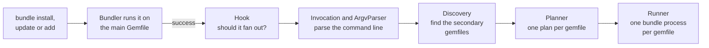
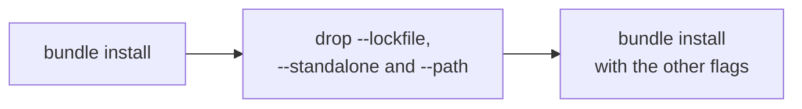
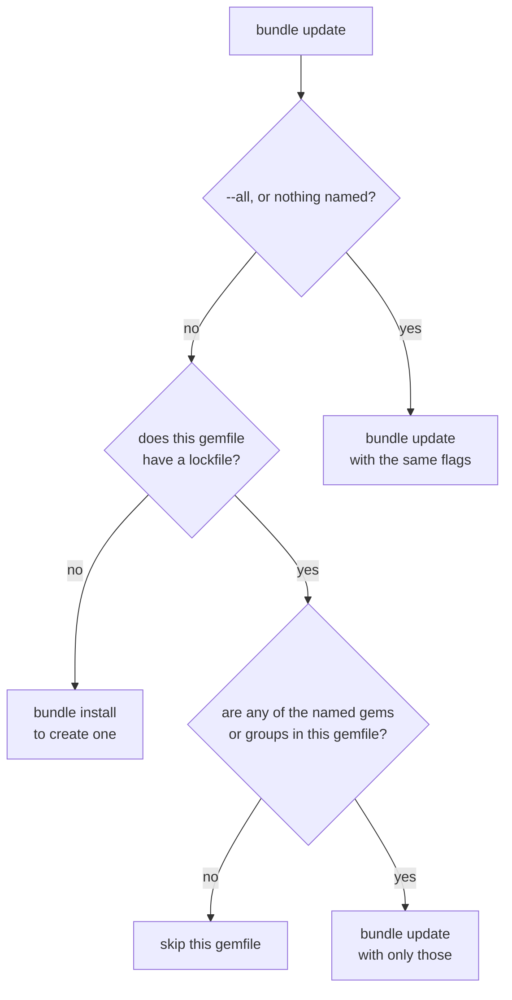
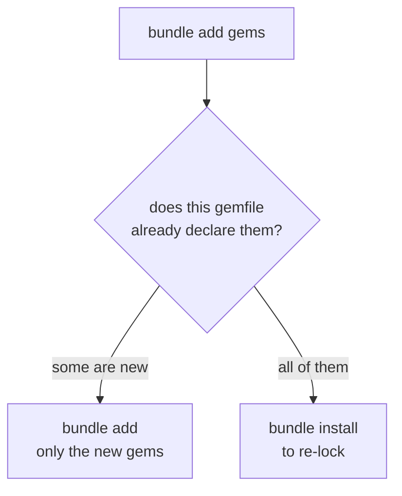
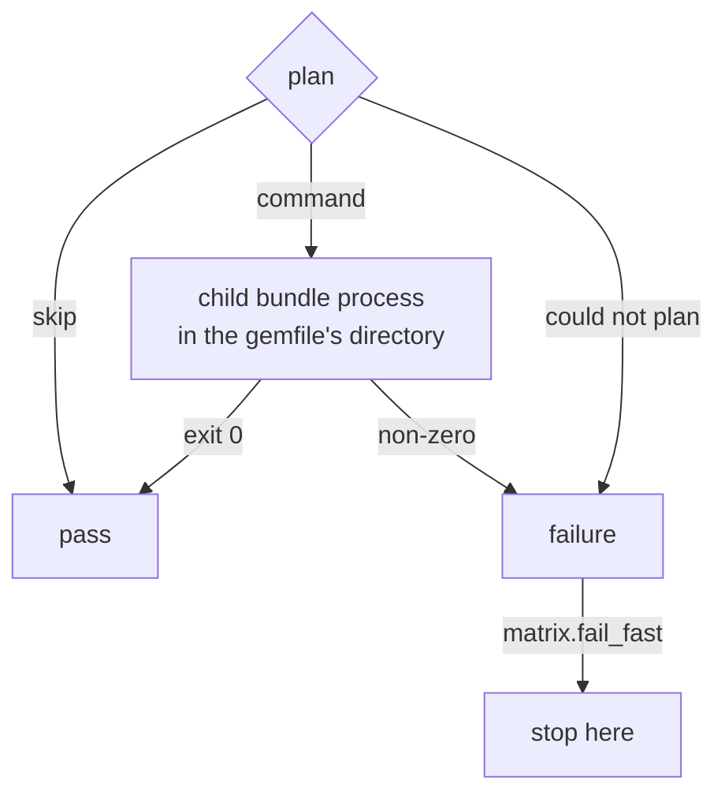
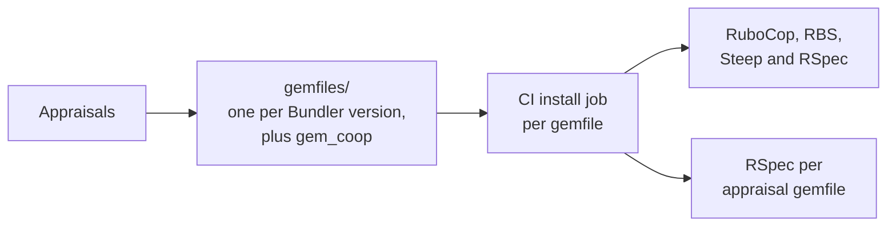

# How bundle_matrix works

After `bundle install`, `bundle update` or `bundle add` succeeds on the main Gemfile, bundle_matrix runs the same command against every secondary gemfile in the project. Each one runs in its own `bundle` process.

## Overview

| Step | Files |
|------|-------|
| Hook: should it fan out? | `hook.rb` |
| Parse the command line | `invocation.rb`, `argv_parser.rb` |
| Read the `matrix.*` settings | `config.rb` |
| Find the secondary gemfiles | `discovery.rb` |
| Plan each gemfile | `planner.rb`, `secondary_gemfile.rb` |
| Run each gemfile | `runner.rb`, `project_settings.rb` |

The hook (`hook.rb`) stops without doing anything when:

- the command isn't `install`, `update` or `add`
- `BUNDLE_MATRIX_ACTIVE` is set, so this is already a child run
- `matrix.disabled` is set
- the command ran on a gemfile other than `matrix.default_gemfile`
- no secondary gemfiles were found

Discovery (`discovery.rb`) looks for `*.gemfile` in the project root, `gemfiles/*.gemfile`, and each `matrix.paths` entry. A directory in `matrix.paths` contributes its `gems.rb`, or else its `Gemfile`. The main gemfile is never included.

Every gemfile is planned before any of them runs. Planning starts by dropping `--gemfile`, then follows one of the three paths below.

## Install

Those three flags only make sense for the main Gemfile, or are ones Bundler no longer accepts (`--path` on Bundler 4). Each one dropped is noted in the output.

## Update

"Named" means gems, `--group`, `--source`, `--ruby` or `--bundler`. Gems are matched against this gemfile's lockfile (`gems.locked` for a `gems.rb`, otherwise `<gemfile>.lock`). Groups are matched against the groups this gemfile declares. An update with `--ruby` or `--bundler` is never skipped.

## Add

Declared gems include those pulled in by `eval_gemfile`. A relative `--path` is rewritten to be relative to the secondary gemfile's directory.

## Running each gemfile

Gemfiles run in sorted order. A gemfile that could not be planned is printed as an error and counts as a failure, and the others still run. If any failed, the run ends with `BundleMatrix::Error`, which names them and exits 1.

The child is a separate process because Bundler keeps global state. It gets:

- the project's `.bundle/config` and the user's `BUNDLE_*` variables, with relative paths made absolute
- `BUNDLE_GEMFILE` set to its gemfile
- `BUNDLE_MATRIX_ACTIVE=1`, so its own hook doesn't fan out again
- no `BUNDLER_VERSION`, so it runs the Bundler named in its own lockfile's `BUNDLED WITH`

## Bundler version warnings

- Before planning, the hook warns when the running Bundler is outside `TESTED_BUNDLER` in `version.rb`.
- Each plan that runs a command carries the Bundler named in its gemfile's lockfile. The runner warns for each one that differs from the main Bundler, when `matrix.bundler_warnings` is on and the `version` setting is `lockfile` or unset. With `system` or a pinned version, every gemfile runs the main Bundler, so nothing is warned. At the end it suggests `bundle update --bundler`, or `bundle config set matrix.bundler_warnings false` to turn these warnings off.

## Development and CI

- `rake` runs `spec`, `e2e`, `rubocop`, `rbs` and `steep`. Steep type checks `lib/` against `sig/`, and `sig_stubs/` declares the parts of Bundler's API the code calls, since Bundler publishes no signatures.
- `MIN_BUNDLER` in `version.rb` sets the gemspec's Bundler dependency, a lower bound only, so a newer Bundler can still install the plugin. `TESTED_BUNDLER` in the same file sets the untested-Bundler warning. `spec/bundle_matrix_spec.rb` checks `TESTED_BUNDLER` against the `gemfiles/bundler_*.gemfile` files the Appraisals generate: every one is in range, and the range stops before the minor after the highest tested one. A new Bundler minor therefore needs the Appraisal and the range changed together.
- The E2E jobs in CI are disabled until the project moves to the public repo.

## Bundler internals we rely on

Parts of the plugin use Bundler code that is not a plugin API, so a Bundler release can change them. The Appraisals guard these: each `gemfiles/bundler_*.gemfile` installs one Bundler version and runs the RSpec suite against it, so a change that breaks one of these fails there.

| Bundler internal | Used in |
|------------------|---------|
| Thor option tables: `Bundler::CLI.commands`, `Bundler::CLI.class_options`, and each option's `type`, `aliases` and `lazy_default` | `argv_parser.rb` (`table_for`, `switch_table`, `values_for`) |
| `Bundler::CLI.map`, the protected `normalize_command_name`, and the `default_cli_command` setting | `argv_parser.rb` (`split_command`, `default_command_used?`, `resolve_command`) |
| `Bundler::LockfileParser`, for `specs` and `bundler_version` | `secondary_gemfile.rb` |
| `Bundler::Dsl`, for `eval_gemfile` and `dependencies` | `secondary_gemfile.rb` |
| `Bundler.settings` `#all`, `#key_for` and `#locations` | `project_settings.rb` |
| `Bundler::SharedHelpers.relative_path_to` | `planner.rb` (`rewrite_path`) |
| The `version` setting, which decides whether each child uses its lockfile's Bundler | `runner.rb` (`other_bundler_for`) |
